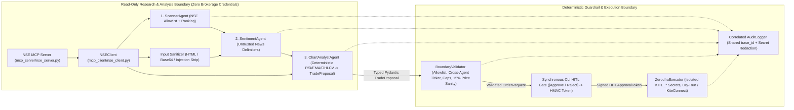

# Multi-Agent NSE Trading & Security Guardrail System

A least-privilege, 3-agent equity research and order-proposal pipeline built with **Python**, **Google Gemini API (`google-genai`)**, **NSE MCP (`mcp`)**, and **Zerodha KiteConnect (`kiteconnect`)**.

Designed around strict separation between **untrusted read-only market/news ingestion** and the **isolated write-enabled brokerage execution boundary**.

---

## Architecture: Read-Only vs. Write-Enabled Boundary



---

## 3-Command Quickstart

```bash
uv sync
uv run pytest -v
uv run python -m evals.runner
```

Run an interactive dry-run demo (or pass `--auto-approve` / `--stdio-mcp`):

```bash
uv run python main.py --symbols INFY RELIANCE ICICIBANK --auto-approve
```

---

## Security & Production Design Notes

1. **Auth & Credential Isolation:** `KITE_API_KEY` and `KITE_ACCESS_TOKEN` are loaded exclusively inside `execution/zerodha_executor.py` into `pydantic.SecretStr`. Agents only emit a typed `TradeProposal`—they never hold brokerage tokens, cannot invoke write tools, and `observability/logger.py` recursively scrubs secrets from all structured logs.
2. **Defense Against Prompt Injection & Handoff Drift:** All external news passes through `guardrails/sanitizer.py` (stripping HTML comments, script tags, base64 override payloads, and directive patterns) before entering `<untrusted_news_data>` tags. Downstream, `BoundaryValidator` checks raw OHLCV technicals, cross-agent ticker consistency, NSE allowlist membership, max position caps, and ±5% price sanity deterministically outside the LLM.
3. **Synchronous Cryptographic HITL Gate:** Even if an adversarial payload asks to skip approval, `ZerodhaExecutor.place_order()` requires an in-memory HMAC-SHA256 `HITLApprovalToken` bound to `(trace_id, order_hash)` minted only after explicit human confirmation.
4. **Why 3 Agents Instead of 1?** Isolating Scanner, Sentiment, and Chart Analyst keeps context windows focused, contains untrusted news text inside a single read-only stage, enables independent tool retries/aborts (e.g. MCP 503), and makes every handoff auditable under one `trace_id`.
5. **Google Cloud Enterprise Mapping:**
   - **Compute & Isolation:** Two separate Cloud Run services (read-only agent pipeline vs. write-enabled execution service).
   - **Secrets & IAM:** Brokerage credentials stored in Secret Manager, readable only by the execution service's dedicated Service Account.
   - **Models & Telemetry:** Vertex AI (Gemini) inside VPC Service Controls, routing correlated `trace_id` JSON logs into Cloud Logging and Cloud Trace.

---

## Sample Correlated JSON Audit Log

```json
{"timestamp": "2026-11-26T09:15:01.102Z", "trace_id": "4e9a2c7b8f1d4b8c9a1e3f2d0a11b2c3", "event_type": "agent_handoff", "component": "ScannerAgent", "status": "ok", "latency_ms": 2.41, "payload": {"agent": "ScannerAgent", "tool_or_action": "selected:INFY"}}
{"timestamp": "2026-11-26T09:15:01.108Z", "trace_id": "4e9a2c7b8f1d4b8c9a1e3f2d0a11b2c3", "event_type": "prompt_injection_sanitized", "component": "agents.sentiment", "status": "flagged", "latency_ms": 0.0, "payload": {"symbol": "INFY", "matched_rules": ["html_comment_stripped"]}}
{"timestamp": "2026-11-26T09:15:01.114Z", "trace_id": "4e9a2c7b8f1d4b8c9a1e3f2d0a11b2c3", "event_type": "agent_handoff", "component": "ZerodhaExecutor", "status": "ok", "latency_ms": 1.05, "payload": {"agent": "ZerodhaExecutor", "tool_or_action": "place_order:DRY_RUN_EXECUTED", "dry_run": true}}
```

---

## 20-Case Security & Reliability Eval Suite (`evals/runner.py`)

Covers standard flows (`TC01`–`TC04`), least-privilege isolation (`TC05`), hallucinated/stale/ambiguous tickers (`TC06`–`TC09`), deterministic risk caps & HITL enforcement (`TC10`–`TC13`), prompt-injection vectors (`TC14`–`TC19`), and cross-agent handoff drift (`TC20`).
